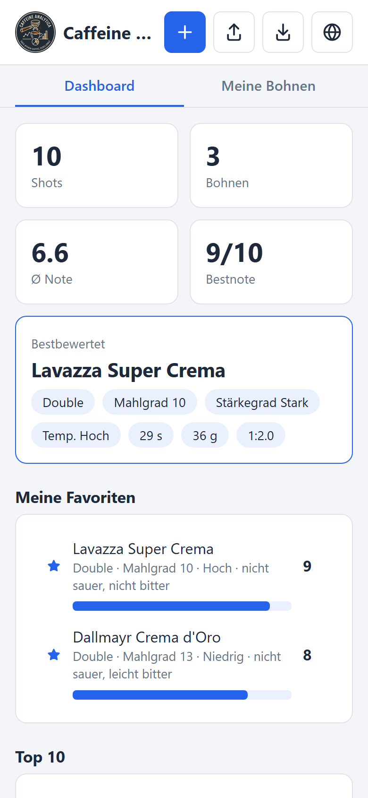
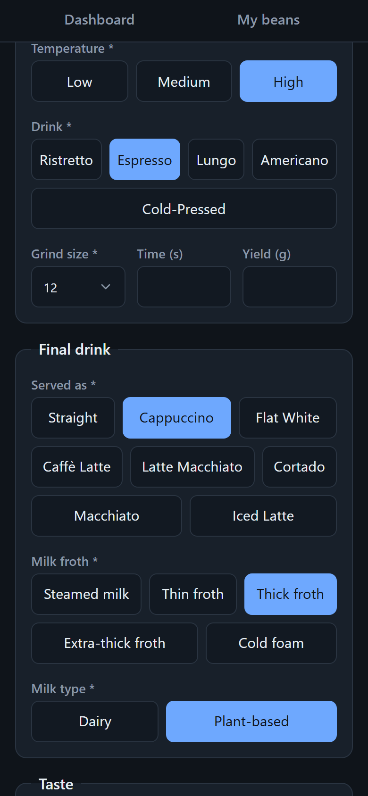
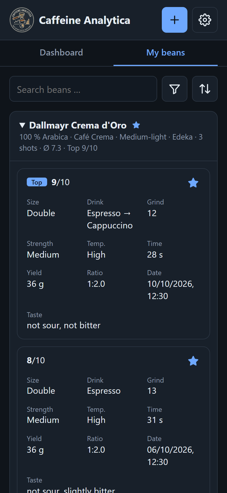
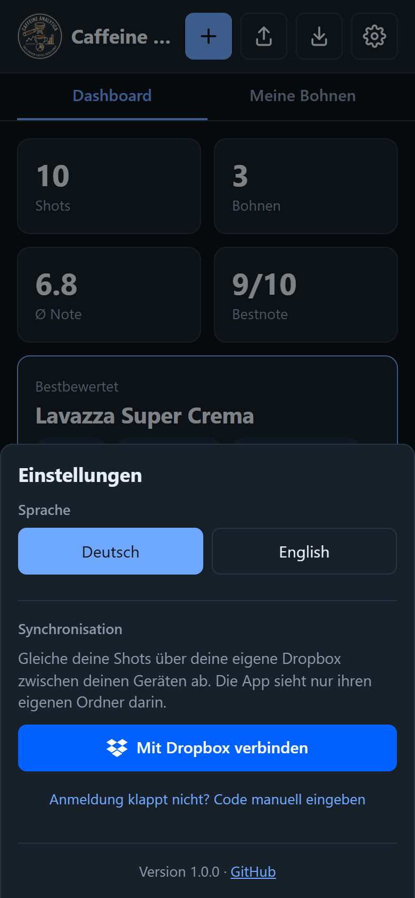

  

<h1 align="center">Caffeine Analytica · Ninja Luxe Pro</h1>

  Kaffee-Logbuch für die Ninja Luxe Pro: finde die beste Einstellung für jede Bohne. 
  <i>Coffee log for the Ninja Luxe Pro: find the best setting for every bean.</i>

  <a href="https://kampfballerina.github.io/Ninja-Cafe-Luxe-Pro-Settings-app/"><b>App öffnen / Open the app</b></a>
  &nbsp;·&nbsp; <a href="#-deutsch">🇩🇪 Deutsch</a>
  &nbsp;·&nbsp; <a href="#-english">🇬🇧 English</a>

  
  &nbsp;
  
  &nbsp;
  
  &nbsp;
  

---

## 🇩🇪 Deutsch

Du protokollierst jeden Shot: welche Bohne, welche Maschineneinstellung und wie er geschmeckt hat. Die App zeigt dir daraus, **was bei welcher Bohne am besten funktioniert**.

Kein Konto, kein Server · offline nutzbar · als App auf dem Homescreen · Hell- und Dunkelmodus · Deutsch und Englisch

### Funktionen

| Funktion | Kurz erklärt |
|---|---|
| **Neuer Shot** | Bohne (Marke, Sorte, Art, Typ, Kaufort, Bild), Maschine (Einsatz, Stärkegrad, Temperatur, Mahlgrad, Dauer, Gewicht) und Geschmack per Schieberegler (sauer, bitter, Stärke, Note 1–10) |
| **Mitdenkendes Formular** | Schlägt bekannte Werte vor, füllt Bohnendaten automatisch aus und übernimmt auf Knopfdruck die beste bisherige Einstellung der Bohne |
| **Tipps** | Aus dem Geschmack werden Hinweise, z. B. „eher sauer → feiner mahlen oder Temperatur höher“. Dazu das Brühverhältnis (z. B. 1:2,0) |
| **Doppelte Shots** | Gleiche Einstellungen werden zusammengefasst und als „2× zubereitet“ gezählt |
| **Dashboard** | Kennzahlen, bester Shot, Favoriten, Top 10, Geschmackskarte (sauer × bitter), Notenverlauf und die beste Einstellung je Bohne |
| **Meine Bohnen** | Alle Bohnen als Karten mit ihren Shots, der beste zuerst. Mit Suche, Filter und Sortierung |
| **Favoriten** | Einzelne Shots mit dem Stern markieren und gezielt filtern |
| **Bohnenbild** | Ein Bild pro Bohne, das bei allen ihren Shots erscheint. Als Link oder Upload (wird automatisch verkleinert) |
| **Export / Import** | Sicherung als JSON-Datei. Beim Import werden die Daten zusammengeführt statt ersetzt |
| **Dropbox-Sync** | Optional: gleicht deine Shots über deine eigene Dropbox zwischen Handy und PC ab (Einstellungen → „Mit Dropbox verbinden“). Die App sieht nur ihren Ordner `Apps/Caffeine Analytica`. Mit „Bilder offline verfügbar“ aus liegen die Bilder nur in der Dropbox und sparen Platz auf dem Gerät |

Ein Tipp auf einen Shot öffnet die Details. Dort kannst du ihn **bearbeiten**, als **Vorlage** nutzen oder **löschen**.

### Auf den Homescreen

| iPhone / iPad (Safari) | Android (Chrome) | PC (Chrome / Edge) |
|---|---|---|
| 1. [App](https://kampfballerina.github.io/Ninja-Cafe-Luxe-Pro-Settings-app/) in **Safari** öffnen 2. **Teilen** antippen (↑, ggf. im ⋯ -Menü) 3. **„Zum Home-Bildschirm“** 4. **„Hinzufügen“** | 1. [App](https://kampfballerina.github.io/Ninja-Cafe-Luxe-Pro-Settings-app/) in **Chrome** öffnen 2. **⋮-Menü** oben rechts 3. **„App installieren“** oder **„Zum Startbildschirm hinzufügen“** 4. Bestätigen | **Installieren-Symbol** in der Adressleiste klicken oder im Menü **„App installieren“** wählen |

Danach startet die App im Vollbild und funktioniert auch ohne Internet.

### Deine Daten

- Alles bleibt **lokal auf deinem Gerät**. Es gibt kein Tracking. Nur wenn du Dropbox verbindest, landen die Daten zusätzlich in deiner eigenen Dropbox (und bei ausgeschalteter Option „Bilder offline verfügbar“ die Bilder nur dort).
- Die App bittet den Browser, die Daten dauerhaft zu speichern, damit er sie nicht bei Speicherknappheit löscht.
- Löschungen und Änderungen werden beim Import berücksichtigt: Pro Shot gewinnt die neuere Änderung, gelöschte Shots tauchen nicht wieder auf.
- Die Daten gehören zu diesem Browser. Auf dem iPhone können Homescreen-App und Safari getrennte Speicher haben.
- Löschst du die Browserdaten oder die App, sind die Daten weg. **Exportiere regelmäßig ein Backup.** So ziehst du auch auf ein neues Handy um.

---

## 🇬🇧 English

Log every shot: which bean, which machine settings and how it tasted. From that, the app shows you **what works best for each bean**.

No account, no server · works offline · installs to your home screen · light and dark mode · German and English

### Features

| Feature | In short |
|---|---|
| **New shot** | Bean (brand, product, species, type, shop, image), machine (shot size, strength, temperature, grind size, time, yield) and taste with sliders (sour, bitter, strength, score 1–10) |
| **Smart form** | Suggests known values, fills in bean details automatically and applies the bean's best setting so far with one tap |
| **Tips** | Turns your taste rating into hints, e.g. “tastes sour → grind finer or raise the temperature”. Also shows the brew ratio (e.g. 1:2.0) |
| **Duplicate shots** | Identical settings are merged and counted as “prepared 2×” |
| **Dashboard** | Key figures, best shot, favorites, top 10, taste map (sour × bitter), score progress and the best setting per bean |
| **My beans** | All beans as cards with their shots, best first. With search, filters and sorting |
| **Favorites** | Mark individual shots with the star and filter for them |
| **Bean image** | One image per bean, shown for all of its shots. As a link or upload (resized automatically) |
| **Export / import** | Back up as a JSON file. Importing merges the data instead of replacing it |
| **Dropbox sync** | Optional: syncs your shots between phone and computer through your own Dropbox (Settings → “Connect to Dropbox”). The app only sees its folder `Apps/Caffeine Analytica`. With “Images available offline” turned off, images are kept only in Dropbox to save space on the device |

Tap a shot to open its details. From there you can **edit** it, use it as a **template** or **delete** it.

### Add to your home screen

| iPhone / iPad (Safari) | Android (Chrome) | Computer (Chrome / Edge) |
|---|---|---|
| 1. Open the [app](https://kampfballerina.github.io/Ninja-Cafe-Luxe-Pro-Settings-app/) in **Safari** 2. Tap **Share** (↑, maybe inside the ⋯ menu) 3. **“Add to Home Screen”** 4. **“Add”** | 1. Open the [app](https://kampfballerina.github.io/Ninja-Cafe-Luxe-Pro-Settings-app/) in **Chrome** 2. **⋮ menu** in the top right 3. **“Install app”** or **“Add to Home screen”** 4. Confirm | Click the **install icon** in the address bar, or choose **“Install app”** from the menu |

The app then opens full screen and also works without internet.

### Your data

- Everything stays **on your device**. There is no tracking. Only if you connect Dropbox is the data also stored in your own Dropbox (and with “Images available offline” turned off, the images only there).
- The app asks the browser to store the data persistently, so it isn't cleared when storage runs low.
- Imports respect changes and deletions: for each shot the newer change wins, and deleted shots don't come back.
- The data belongs to this browser. On an iPhone, the home screen app and Safari may have separate storage.
- If you clear the browser data or delete the app, your data is gone. **Export a backup regularly.** That's also how you move to a new phone.

---

<b>Technik / Tech</b>

 

- `index.html` (HTML, CSS, JavaScript) plus `sync.js` für Dropbox, ohne Frameworks und ohne Build-Schritt.
  · `index.html` (HTML, CSS, JavaScript) plus `sync.js` for Dropbox, with no frameworks and no build step.
- Daten liegen in IndexedDB (Rückfall: localStorage). Jeder Shot trägt einen Änderungszeitpunkt (`updated`), gelöschte Shots bleiben als Löschmarke (`deleted`) erhalten. Der Export hat das Format `{version: 2, shots, deleted}`, alte Exporte (nur die Liste) lassen sich weiter importieren.
  · Data lives in IndexedDB (fallback: localStorage). Each shot carries a change time (`updated`), deleted shots are kept as tombstones (`deleted`). Exports use `{version: 2, shots, deleted}`; old exports (just the list) can still be imported.
- **Dropbox-Sync** (`sync.js`, ohne Bibliotheken): Login per OAuth mit PKCE direkt aus dem Browser, ohne Server. Im App-Ordner liegen `data.json` (Shots + Löschmarken, Bilder als Verweis `img:<sha256>`) und `images/`. Ein Abgleich lädt `data.json`, führt pro Shot zusammen (neuere Änderung gewinnt) und lädt nur hoch, wenn sich die Datei seitdem nicht geändert hat, sonst beginnt er von vorn.
  · **Dropbox sync** (`sync.js`, no libraries): OAuth with PKCE straight from the browser, no server. The app folder holds `data.json` (shots + tombstones, images as `img:<sha256>` references) and `images/`. A sync downloads `data.json`, merges per shot (newer change wins) and only uploads if the file hasn't changed in the meantime, otherwise it starts over.
- `manifest.webmanifest` und `sw.js` (Service Worker) sorgen für Installation und Offline-Betrieb. Gehostet wird über GitHub Pages.
  · `manifest.webmanifest` and `sw.js` (service worker) handle installation and offline use. Hosted on GitHub Pages.
- **Lokal starten / Run locally:** `index.html` im Browser öffnen. Der Service Worker läuft nur über `https` oder `localhost`, z. B. mit `npx serve`.
  · Open `index.html` in a browser. The service worker only runs over `https` or on `localhost`, e.g. with `npx serve`.
- **Updates:** Mit Internet lädt die App immer die aktuelle Version, ohne Internet die zuletzt geladene aus dem Cache.
  · With internet the app always loads the latest version, offline it uses the last one from the cache.
- **Version:** `APP_VERSION` in `index.html` bei jeder Veröffentlichung hochzählen, sie steht in den Einstellungen.
  · Bump `APP_VERSION` in `index.html` with every release, it is shown in the settings.
- **Neue oder umbenannte Dateien / New or renamed files:** `FILES` in `sw.js` anpassen und `CACHE` hochzählen (z. B. `kaffee-v2` → `kaffee-v3`).
  · Update `FILES` in `sw.js` and bump `CACHE`.

## Lizenz / License

MIT – siehe / see [LICENSE](LICENSE).
